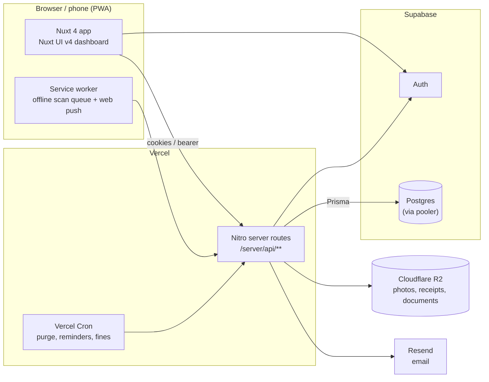
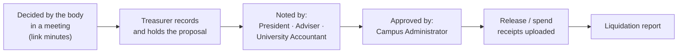
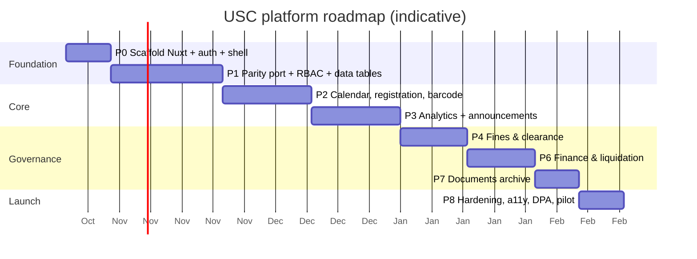

# USC Attendance → Professional USC Platform — Master Plan

> **Status:** Draft v1.1 (USC answers folded in) · 2026-10-17 · Owner: Jeff (Syntaxure Labs) · Audience: Jeff, the USC President, and any AI coding agent working in this repo.
>
> **Public site freeze (2026-10-17):** the public website stays exactly as it is until Jeff approves a change — see [PUBLIC-SITE-FREEZE.md](PUBLIC-SITE-FREEZE.md) for the rules, the parity gate (`tools/public-parity`) and the branch workflow (`feat/*` → `develop` after every phase; `develop` → `main` only at the cutover).
>
> **For agents:** this is the source of truth for scope, order and conventions. Read [§13 Agent working agreement](#13-agent-working-agreement) before writing code, and tick the [§14 tracker](#14-progress-tracker) as phases land. Do not start a phase whose open questions in [§12](#12-open-questions-for-jeff--the-usc) are still unanswered without asking.

---

## TL;DR

| | |
|---|---|
| **Goal** | Turn the current attendance app into a complete, professional platform for the ISUFST Dingle Campus University Student Council (USC). |
| **Decided stack** | **Nuxt 4 + Nuxt UI v4** (free, MIT, includes a free Dashboard template), Prisma + Supabase Postgres + Supabase Auth, deployed on Vercel. |
| **Scope** | USC only (single organization), English only. Modules: events calendar + registration, attendance analytics & reports, announcements & notifications, student-number scanning (ID barcode once MIS adds it), absence fines & clearance (default ₱50 absent / ₱25 late), finance & liquidation, documents & resolutions archive. **Elections are deferred** (COMELEC exists; not election season). |
| **Strategy** | Incremental "strangler" rebuild on a branch: scaffold Nuxt, port the existing hardened API logic and pages to parity, then add modules one phase at a time. Database stays; nothing already built is thrown away. |
| **Benchmarks** | CampusGroups (Ready Education), Anthology Engage, Presence (Modern Campus): rosters, events, swipe/QR check-in, refreshing QR, elections, org finance, analytics. Research on fraud-resistant attendance backs our approach of refreshing QR + geofence + officer-recorded check-in. |
| **Rough effort** | ~14–21 weeks for one developer working with AI agents with elections deferred (ranges per phase in [§9](#9-phased-roadmap)). Parity alone ≈ 3–5 weeks. |
| **Budget** | **₱0 hosting budget for now** — everything is designed to fit free tiers (see [§11.1](#111-free-tier-constraints-no-hosting-budget)). |
| **Biggest risks** | Free-tier limits (Supabase paused once already; Vercel Hobby is non-commercial; email sending is capped), student data privacy (Data Privacy Act of 2012), and scope creep. |

---

## Table of contents

1. [Where we are today](#1-where-we-are-today)
2. [Benchmarks — what "professional" looks like](#2-benchmarks--what-professional-looks-like)
3. [Feature gap matrix](#3-feature-gap-matrix)
4. [Decisions locked](#4-decisions-locked)
5. [Target architecture](#5-target-architecture)
6. [Libraries and templates (don't build from scratch)](#6-libraries-and-templates-dont-build-from-scratch)
7. [Roles and permissions](#7-roles-and-permissions)
8. [Module specifications](#8-module-specifications)
9. [Phased roadmap](#9-phased-roadmap)
10. [Quality bar — definition of done](#10-quality-bar--definition-of-done)
11. [Security, privacy and compliance](#11-security-privacy-and-compliance)
12. [Open questions for Jeff / the USC](#12-open-questions-for-jeff--the-usc)
13. [Agent working agreement](#13-agent-working-agreement)
14. [Progress tracker](#14-progress-tracker)
15. [Risks and mitigations](#15-risks-and-mitigations)
16. [Sources](#16-sources)

---

## 1. Where we are today

Live at **https://usc.syntaxure.dev** (Vue 3 + Vite SPA, one Vercel catch-all API function `api/index.ts`, Prisma, Supabase Postgres + Auth, Resend email). `main` @ `6fdff03`.

**Already built and tested (keep all of it):**

| Area | What exists |
|---|---|
| Accounts | Officer accounts (17), forced first-login password change enforced **server-side**, password reset via Resend, deactivation enforced everywhere. |
| Students | Self-registration (`@isufst.edu.ph` + student ID + email verification, password set after verifying), super-admin student management. |
| Check-in | Server-signed rotating QR (60 s), officer scans; scanner must be inside the event geofence (+GPS accuracy allowance); self check-in for officers with geofence; per-event check-in window; office-duty check-in/out with time windows. |
| Delegation | President/Secretary grant temporary per-event scopes (scan, manual entry, roster, export), auto-expiry, instant revoke. |
| E-signature | Student signs on phone after being scanned; PNG + SHA-256; per-semester retention with nightly purge (Vercel Cron). |
| Reports | Attendance export as PDF, Excel and CSV (with E-Signature column). |
| Governance | Audit log for every sensitive action; "Settings manager" role for adviser / officer in charge. |
| Tests | 92 unit tests (Vitest) + 113 live end-to-end checks (`scripts/e2e/*.e2e.mts`). |
| Public site | CMS-driven public pages (About, Officers, Projects, Events, Campus Guide, Privacy). |

**Known limitations driving this plan:** hand-rolled UI (no design system, basic tables, no calendar, no filters/saved views), no analytics, no notifications, student profile lacks college/year/section, and no governance modules (fines, elections, finance, documents).

---

## 2. Benchmarks — what "professional" looks like

### 2.1 Commercial campus-engagement platforms

| Platform | Relevant capabilities (from vendor and university sources) | What we take from it |
|---|---|---|
| **CampusGroups** (Ready Education) | Attendance via **card swipe and a QR code that refreshes every 30 s**; mobile check-in without laptops or swipers (Harvard GSAS); budgeting tools; learning pathways; drag-and-drop org websites. | Refreshing QR (we have 60 s → move to 30 s), phone-only check-in, budgeting. |
| **Anthology Engage** | Org registration/renewal/**elections**, rosters, document management, **finance (general ledger, funding & purchase requests)**, event promotion, **Card Swipe module + Event Check-In App**, co-curricular paths, API. | Elections, finance requests, documents, role permissions. |
| **Presence** (Modern Campus) | Event attendance and engagement tracking; limited financial support per one university IT comparison. | Engagement analytics focus. |

*Caveat:* much of the comparison material is vendor-authored (Ready Education sells CampusGroups); treat feature claims as indicative, not verified.

### 2.2 Research on fraud-resistant attendance

| Finding | Source | Our status |
|---|---|---|
| Layered validation: **time-limited dynamic QR + duplicate checks + device binding + Haversine geofencing** | AttendEase (2026, small pilot, 48 students) | Dynamic QR ✅, duplicates ✅, geofence ✅ (on the **scanner**), device binding ❌ → planned (optional) |
| Static QR codes fail against remote image sharing | AttendEase | We never use static codes ✅ |
| Browser geolocation accuracy varies by device/network | Student project reports | We cap an accuracy allowance (≤100 m) ✅ |
| Real-time dashboards and aggregated reports are expected | AttendEase, Q-Track | Planned (Phase 3) |
| Configurable absence thresholds trigger automated tracking | Yarmouk University project | Planned as fines/sanctions (Phase 4) |

No standard benchmark exists for spoof rates or latency; we define our own acceptance tests (see §10).

### 2.3 Templates

There is **no mature open-source template made specifically for student-council attendance** in Next.js or Nuxt; the realistic path is a **generic, high-quality admin template** plus domain modules. The closest fits:

| Template | Stack | Notes |
|---|---|---|
| **Nuxt UI Dashboard template** ✅ *chosen* | Nuxt 4 + Nuxt UI v4, MIT | Free since Nuxt UI v4 merged Pro into the free library; collapsible sidebar, keyboard shortcuts, light/dark, command palette, multiple pages; Deploy-to-Vercel. |
| shadcn-vue-admin (whbbit1999) | Vue 3.5 + Vite + shadcn-vue + TanStack Table/Query, MIT (~459★) | Strong reference for data-table patterns (server pagination, faceted filters, bulk actions) if we ever stay on plain Vue. |
| Kiranism next-shadcn-dashboard-starter | Next.js 16 + shadcn/ui, MIT (~7.1k★) | Most popular Next.js admin; Clerk auth, TanStack Table + nuqs URL-synced filters. Not chosen (React rewrite + Clerk conflicts with Supabase Auth), but a good UX reference for tables/filters. |
| satnaing/shadcn-admin | React + Vite, ~12k★ | UX reference only. |

---

## 3. Feature gap matrix

Legend: ✅ have · 🟡 partial · ❌ missing · 🎯 planned phase

| Capability | CampusGroups / Engage | Us today | Plan |
|---|---|---|---|
| Event creation, venue, geofence | ✅ | ✅ | keep |
| **Event calendar (month/week/list)** | ✅ | ❌ | 🎯 P2 |
| Event categories, required attendees, capacity, RSVP/registration, waitlist | ✅ | ❌ | 🎯 P2 |
| QR check-in (refreshing) | ✅ (30 s) | ✅ (60 s) | 🎯 P1 → 30 s |
| Card / **ID barcode** check-in | ✅ (swipe) | ❌ | 🎯 P2 (phone camera scans printed school ID) |
| Offline check-in queue | 🟡 | 🟡 (self only) | 🎯 P2 (scanner) |
| Check-out / duration | 🟡 | ✅ | keep |
| Delegated event staff | ✅ (permissions) | ✅ | keep |
| E-signature on attendance | ❌ | ✅ | keep (differentiator) |
| **Pro data tables** (server filters, facets, saved views, column chooser, bulk actions) | ✅ | ❌ | 🎯 P1 |
| **Analytics dashboards** | ✅ | ❌ | 🎯 P3 |
| Exports PDF/Excel/CSV | ✅ | ✅ | extend to every table (P1/P3) |
| **Announcements, email, push, reminders** | ✅ | ❌ | 🎯 P3 |
| **Absence fines, excuses, clearance** | 🟡 (via sanctions/paths) | ❌ | 🎯 P4 |
| **Elections / voting** | ✅ | ❌ | 🎯 P5 |
| **Budget, expenses, liquidation** | ✅ | ❌ | 🎯 P6 |
| **Documents, resolutions archive** | ✅ | ❌ | 🎯 P7 |
| Audit log | ✅ | ✅ | extend to all modules |
| Data retention controls | 🟡 | ✅ (signatures) | extend (P8) |
| Public website / CMS | ✅ | ✅ | port (P1) |

---

## 4. Decisions locked

| # | Decision | Chosen | Notes |
|---|---|---|---|
| D1 | Framework | **Nuxt 4 + Nuxt UI v4** | Vue skills/components carry over; free dashboard template; Nitro server routes replace `api/index.ts`. |
| D2 | Tenancy | **USC only** | Design tables with an `organizationId`-free schema now; keep module boundaries clean so multi-org can be added later if ever needed. |
| D3 | Core modules | Events calendar + registration, analytics & reports, announcements & notifications, student-ID barcode scanning | |
| D4 | Extra modules | Fines & clearance, elections, finance & liquidation, documents archive | |
| D5 | Database & auth | **Keep** Supabase Postgres + Supabase Auth + Prisma | Schema already migrated; no data migration needed. |
| D6 | Hosting | **Keep** Vercel (Nitro `vercel` preset) | Cron already configured. |
| D7 | Check-in model | Officer records students (scan QR / ID barcode); students sign afterwards | Already built; keep. |
| D8 | Elections | **Deferred** to the backlog | A COMELEC exists but it's not election season; spec kept in §8.6 for later. |
| D9 | Language | **English only** | No i18n layer needed in v1 (keep strings in components tidy so it can be added). |
| D10 | Hosting budget | **₱0 — free tiers only** for now | Constraints in §11.1; revisit if the USC funds a proposal. |
| D11 | Academic reference data | **Editable by admins**: colleges, programs, year levels, sections | Seed the 4 colleges; programs default to 4 year levels, editable (e.g., a 5-year program). Sections are encoded by the admin. |
| D12 | Fines defaults | **₱50 per absence, ₱25 per late**, editable by admin | Per-event overrides allowed. |
| D13 | ID barcode | **Not on school IDs yet** | Build scanning of the student number (QR/barcode) so it works the day MIS adds barcodes; the USC will propose it to MIS/Admin. Student QR remains the main path. |

---

## 5. Target architecture



**Layout of the new app (Nuxt 4 `app/` directory convention):**

```text
app/
  layouts/        dashboard.vue (Nuxt UI dashboard shell), public.vue, auth.vue
  pages/          (public site) / about / events …, (portal) /dashboard /events /attendance …
  components/     domain components grouped by module (events/, attendance/, fines/ …)
  composables/    useAuth, usePermissions, useDataTable (URL-synced filters), useScanner
server/
  api/            one file per route, same URLs as today (/api/attendance/qr, …)
  utils/          ported pure logic: attendance-rules, delegation, retention, report, qr, students, signature
  middleware/     auth → event.context.user, rate limits
prisma/           unchanged schema + new additive migrations
tests/            Vitest unit (ported from api/_lib/*.test.ts) + e2e (ported scripts) + Playwright UI
```

**Porting principle:** every pure module in `api/_lib/` (rules, delegation, retention, report, qr, signature, students) moves **unchanged** to `server/utils/`, keeping its unit tests. Only the thin request/response wrappers change (Vercel `req/res` → H3 `event`). API URLs stay identical so the live e2e suites keep working.

---

## 6. Libraries and templates (don't build from scratch)

| Need | Recommendation | Why / alternatives |
|---|---|---|
| App shell, sidebar, command palette, forms, modals, toasts | **Nuxt UI v4** + its **Dashboard template** | Free, MIT, Tailwind v4, Reka UI primitives, accessible. |
| Data tables (filters, sorting, column visibility, selection, expandable rows, virtualization) | **Nuxt UI `UTable`** (built on **TanStack Table v8**) | Same engine as the industry-standard shadcn data-table. Add our own `useDataTable` composable for **server-side** pagination/filter/sort synced to the URL (VueUse `useRouteQuery`) and **saved views**. |
| Event calendar (month/week/day/list, drag-and-drop) | **FullCalendar** core (MIT) with the official Vue 3 component | Mature (~20k★); the MIT core covers month/week/list + drag & drop; paid "Premium" is only needed for resource/timeline views, which we don't need. **Alternative:** Schedule-X (MIT, Vue adapter, modern) — verify which features are in its free tier before choosing. |
| Charts | **Unovis** (`@unovis/vue`) | Used by the Nuxt/shadcn ecosystem; alternative: `vue-echarts` for heavier dashboards. |
| Forms + validation | Nuxt UI `UForm` + **Zod** (shared schemas between client and server) | One schema per entity in `shared/`. |
| Server state / caching | Nuxt `useFetch`/`useAsyncData` (+ **Pinia Colada** if needed) | Keep simple; avoid two caching layers. |
| Auth | **`@nuxtjs/supabase`** | Cookie-based SSR session; server gets the user in middleware. |
| QR + **1D barcode** scanning | **`vue-qrcode-reader`** (BarcodeDetector API + zxing-wasm polyfill; supports QR and Code 128/39/EAN) | Replaces `html5-qrcode`; one component for both student QR and printed school-ID barcodes. |
| PDF / Excel | Keep **pdf-lib** + **exceljs** (already proven on Vercel) | Reuse `report.ts`. |
| Email | Keep **Resend**; templates with **Vue Email** | Batch sending for announcements (respect rate limits). |
| Push notifications | Web Push via the PWA service worker (**`@vite-pwa/nuxt`**) | No paid push service needed. |
| Rich text (announcements, documents) | **Tiptap** (Nuxt UI v4 ships an editor built on it) | |
| Full-text search (documents) | Postgres `tsvector` + GIN index | No external search service. |
| Dates / time zone | `date-fns` + `@date-fns/tz` (Asia/Manila) | Centralize Manila handling (today scattered). |
| Testing | **Vitest** + `@nuxt/test-utils`, **Playwright** for UI flows, keep live e2e scripts | |
| Error tracking | **Sentry** for Nuxt (free tier) | |

---

## 7. Roles and permissions

### 7.1 Current officers (2026 org chart) and their access

| Person | Position | System access today |
|---|---|---|
| Jonard V. Verdeflor | Adviser | **No account yet** (needs a school email) → Settings manager |
| Rowena S. Borcelo | Co-Adviser | **No account yet** (needs a school email) → Settings manager |
| Jared S. Demonteverde | President | super_admin + delegate + settings |
| Katherine Anne B. Bicodo | Vice President | **same as President**: super_admin + delegate + settings (applied 2026-10-17) |
| Dein Andrey D. Daguro | Senate President | staff |
| Nikki Loraine B. Danugrao | Secretary | staff + delegate + settings |
| Chene D. Manderico | Treasurer | staff (applied 2026-10-17); treasurer capabilities arrive with fines/finance |
| Lianne B. Parcia | Auditor | staff |
| Rena Grace B. Aquiño | Spokesperson | staff |
| Jeff Edrick C. Martinez | **Officer in Charge** | staff + settings (applied 2026-10-17) |
| — | Senate Press | **vacant** |
| Senators (Nezie Ann A. Deang, John David A. Natalio, John Emiel P. Balinas, Andro Renz D. Perisme, Reynald S. Almirante, Jona Ross P. Frial) | Senator | client |
| University Accountant, Campus Administrator | external signatories (finance) | no accounts (see §8.7) |

### 7.2 Capability matrix (target)

Today permissions are a mix of `role` + flags (`canDelegate`, `canConfigure`, `canManageContent`). Phase 1 replaces this with a **capability-based RBAC** table so new modules don't add new booleans.

| Capability | Super admin | President / VP | Secretary | Treasurer | Auditor | Adviser | Officer in charge | Officers (staff) | Officers (client) | Delegate (per event) | Student |
|---|---|---|---|---|---|---|---|---|---|---|---|
| Manage users / roles | ✅ | 🟡 view | | | | | | | | | |
| Create/edit events | ✅ | ✅ | ✅ | | | ✅ | ✅ | ✅ | | | |
| Set check-in windows, retention, semesters | ✅ | ✅ | ✅ | | | ✅ | ✅ | | | | |
| Grant event delegation | ✅ | ✅ | ✅ | | | | | | | | |
| Scan / record attendance | ✅ | ✅ | ✅ | | | | ✅ | ✅ | | scope | |
| View analytics | ✅ | ✅ | ✅ | ✅ | ✅ | ✅ | ✅ | ✅ | | | own |
| Send announcements | ✅ | ✅ | ✅ | | | ✅ | ✅ | | | | |
| Fines: rules / waive | ✅ | ✅ | | ✅ | | ✅ | | | | | |
| Fines: record payment | ✅ | | | ✅ | | | | | | | |
| Clearance: issue | ✅ | ✅ | | ✅ | ✅ | ✅ | | | | | own view |
| Elections: configure | ✅ | | | | | ✅ (COMELEC) | | | | | |
| Elections: vote | | | | | | | | | | | ✅ |
| Finance: request / approve | ✅ | approve | | request | audit | approve | | request | | | |
| Documents: publish | ✅ | ✅ | ✅ | | | ✅ | | | | | public only |

*Election administration is usually handled by an independent electoral board (COMELEC) — see open question Q7.*

---

## 8. Module specifications

Each module lists **scope**, **data model (additive)**, **key rules**, and **acceptance tests**. All tables get `createdAt`, audit logging on writes, and Zod-validated APIs.

### 8.1 Foundation (Phase 0–1)

- Nuxt 4 scaffold from the Nuxt UI Dashboard template; Tailwind theme with USC navy/gold.
- Port all existing pages and API routes to parity (see §1).
- **Academic reference data (all editable by admins):**
  - `colleges` — code + name. Seed: **CICI** College of Informatics and Computing Innovations · **CoAg** College of Agriculture · **CBMSD** College of Business Management and Sustainable Development · **CoEd** College of Education.
  - `programs` — belongs to a college; code, name, **`yearLevels` (default 4, editable, e.g. 5)**; programs are added by the admin.
  - `sections` — belongs to a program + year level; name encoded by the admin (they vary per term).
  - Renaming a college/program updates everywhere (foreign keys, not copied text); deleting is blocked while students reference it (archive instead).
- **Student profile extension:** `collegeId`, `programId`, `yearLevel` (1…program.yearLevels), `sectionId?`, `contactNumber?` on `student_profiles`; registration form uses dropdowns from the reference data; admin can correct any field. *Needed for every filter and analytics view.*
- **RBAC:** `roles`, `role_capabilities`, `user_roles` (a user can hold several, e.g. Secretary + Officer); migrate existing flags.
- **`useDataTable`**: server-side paging/sort/filter, URL-synced, saved views per user, column chooser, CSV/Excel/PDF export of the current filter.
- QR refresh 60 s → 30 s (benchmark parity).

### 8.2 Events calendar + registration (Phase 2)

- Calendar (month/week/list) with color-coded **categories** (General Assembly, Flag Ceremony, Seminar, Sports, …).
- Event fields: description, venue + geofence, start/end, check-in window, **required audience** (all / college / year level / section), capacity, registration required?, waitlist, attachments, cover image.
- **Registration/RSVP**: students register; capacity + waitlist with auto-promotion; reminders (see 8.4).
- **Recurring events** (e.g., weekly flag ceremony) via RRULE.
- **Student-number scanning** in the scanner: reads a QR/1D barcode that encodes the student number → looks up `studentNo` → records attendance (no phone needed). **ISUFST IDs have no barcode yet**; the USC will propose adding one to MIS/Admin, so this ships ready but secondary to the student QR. Until then, officers can also search a student by number/name as a manual fallback. Signature for phone-less students: sign on the officer's device (default; see Q5).
- **Offline scanner queue**: scans saved locally and synced when online (signed tokens verified server-side on sync, with original scan time + location).
- *Acceptance:* create recurring event → calendar shows instances; register beyond capacity → waitlisted; barcode scan of a test ID records the right student; offline scans sync once.

### 8.3 Attendance analytics & reports (Phase 3)

- **Dashboards:** attendance rate per event, trend per semester, by college / year / section, top/bottom attendance, no-show lists, check-in timing histogram, signature completion rate.
- **Student 360:** a student's attendance history, fines, clearance status (also visible to the student on their own dashboard).
- **Reports:** filterable tables everywhere; scheduled report email (weekly summary to President/Adviser); official PDF report template with USC letterhead and signatories.
- *Acceptance:* numbers on dashboards reconcile with raw exports for a seeded dataset.

### 8.4 Announcements & notifications (Phase 3)

- Compose (rich text), audience filter (all / college / year / section / registrants of an event / officers), schedule send, pin.
- Channels: **in-app inbox**, **email** (Resend, batched), **web push** (PWA).
- Automatic notifications: event reminder (24 h / 1 h), registration confirmations, waitlist promotion, fine issued, clearance status changes, election open/close.
- Delivery log + per-user notification preferences.
- *Acceptance:* a scheduled announcement to one college reaches only that college across all three channels; unsubscribe from email honored.

### 8.5 Absence fines & clearance (Phase 4)

- **Fine rules**: global defaults **₱50 per absence** and **₱25 per late** (admin-editable), with optional per-event or per-category overrides; applies to the event's required audience; a configurable late threshold (minutes after the window opens).
- **Authority and sanction type** *(benchmark BC-7 — before cutover)*: a **monetary** fine is only offered when the rule carries an `authorityRef` (the council resolution, and who approved it) and an `effectiveFrom` date; otherwise `sanctionType` is `warning` or `service`. The platform does not decide whether the council may charge money — Q-New-1 does — it records which decision was taken, by whom, so the policy can change without a code change. *(Schema addition pending; see the §14 amendment queue.)*
- **Dispute before collection** *(BC-7)*: a generated fine is `disputable` for *n* days (default 7). A dispute states a *fact* ("I was present", "the event was cancelled", "I was on official duty") and is decided like an excuse — but is not evidence of absence, which is why it is a separate flow from an excuse. Only when the window closes does the fine become `payable`.
- **Nothing is charged for an event that did not happen** *(BC-7; **built** in `feat/p4e-event-cancellation`)*: `Event` carries `status` (`scheduled` · `cancelled`) with a reason, who and when; the fine job skips anything not scheduled, the reminder job skips it, check-ins and registrations are refused, and cancelling notifies the expected audience once. *Still to add from BC-7: voiding fines that were already generated when an event is cancelled after the fact, and the per-semester cap.*
- After an event's window closes (cron), **no-shows** among the required audience get a fine; late arrivals get the late rate.
- **Excuse requests** with attachment (medical, academic conflict) → approve/deny → fine waived.
- **Payments** recorded by the Treasurer (cash; OR number; optional GCash reference) — *no online payment collection in v1*.
- **Clearance**: a student is cleared when they have no unpaid fines; printable clearance PDF with a **verification QR** that anyone can check at `/verify/<code>`.
- *Acceptance:* event closes → correct fines generated; approved excuse waives; payment clears; verification page confirms authenticity and tamper attempts fail.

### 8.6 Elections / voting — **DEFERRED** (backlog)

> Not in the current roadmap: a COMELEC exists but it isn't election season. The spec below is kept so it can be picked up later; review it with the COMELEC first.


- Election setup: positions, number of seats, eligibility (e.g., all enrolled students; college-specific positions), filing period, campaign period, voting window.
- Candidate filing with requirements upload; COMELEC review.
- **Voting:** one verified student = one ballot; **ballot secrecy** by storing *who voted* (voter roll) separately from *what was voted* (anonymous ballots with random IDs, no user link); each voter gets a receipt code to confirm their ballot was counted.
- Results locked until the window closes; live turnout only; tally export; audit trail of configuration changes.
- *Acceptance:* double voting impossible (including concurrent requests); ballots can't be linked to voters from the DB; tally reproducible from ballots.

### 8.7 Finance, budget & liquidation (Phase 6)

- Budget per semester with line items; income (e.g., collected fines, fees) and expenses.
- **Budget proposal workflow (rough sketch from the USC, to be verified with the school):**



  - Officers in the system (Treasurer, President, Adviser) act in-app; the **University Accountant and Campus Administrator are external**: the Treasurer records their *noted/approved* step with date + an uploaded signed copy (no accounts needed in v1; optional limited accounts later).
  - Each step is time-stamped and audited; a proposal can't move to "approved" without every "noted by" step.
- Receipt uploads (R2), liquidation report per event/project (PDF/Excel).
- Read-only **transparency board** (optional public summary).
- *Acceptance:* expense can't exceed remaining line budget without override; liquidation totals reconcile; every approval audited.

### 8.8 Documents & resolutions archive (Phase 7)

- Types: minutes, resolutions, memos, constitution/by-laws, reports; auto-numbering (e.g., *Resolution No. 2026-014*).
- Versions, attachments, tags, visibility (public / officers), full-text search, link documents to events/elections/finance records.
- *Acceptance:* search finds a phrase inside an uploaded document's text; public visitors only see public documents.

---

## 9. Phased roadmap

Estimates assume **one developer working with AI agents**, part-time-friendly ranges. Each phase ends deployable behind the live site (previews), with tests.



| Phase | Deliverable | Effort | Exit criteria |
|---|---|---|---|
| **P0** Foundation | Nuxt 4 + Nuxt UI dashboard scaffold, `@nuxtjs/supabase` auth, layouts, theme, CI (lint, typecheck, unit), Vercel preview | 1–2 wk | Login works on preview; ported unit tests pass. |
| **P1** Parity | All current pages + API ported; RBAC tables; `useDataTable`; student profile extension; QR 30 s; cutover plan | 3–5 wk | All 113 live e2e checks pass against the Nuxt API; feature checklist (§1) ticked; **cutover** of `usc.syntaxure.dev`. |
| **P2** Events | Calendar, categories, recurrence, registration + waitlist, ID-barcode scanning, offline scanner | 3–4 wk | §8.2 acceptance. |
| **P3** Insight & comms | Analytics dashboards, Student 360, report templates, announcements (in-app/email/push), reminders | 3–4 wk | §8.3–8.4 acceptance. |
| **P4** Fines | Rules, auto-generation, excuses, payments, clearance + verification | 2–3 wk | §8.5 acceptance. |
| ~~P5~~ Elections | **Deferred** — not election season | — | Revisit with the COMELEC. |
| **P6** Finance | Budgets, requests, approvals, receipts, liquidation | 2–3 wk | §8.7 acceptance. |
| **P7** Documents | Archive, numbering, versions, search | 1–2 wk | §8.8 acceptance. |
| **P8** Launch | Accessibility (WCAG 2.1 AA), performance, DPA paperwork, load test, pilot event, training | 1–2 wk | Pilot event run with real students; sign-off from President/Adviser. |

**Cutover strategy (end of P1):** build the Nuxt app on a long-lived branch with its own preview URL; run both against the same database; when parity e2e passes, switch the Vercel project's framework preset to Nuxt and merge. Rollback = redeploy the last Vite build (kept tagged `pre-nuxt`).

---

## 10. Quality bar — definition of done

A phase/feature is done only when:

- [ ] Zod-validated API with authorization checked **server-side** (never UI-only), audit-logged writes.
- [ ] Unit tests for pure logic + live e2e checks for each endpoint's allow/deny paths (pattern: `scripts/e2e/*.e2e.mts`, throwaway data, full cleanup).
- [ ] Playwright test for the main UI flow on mobile (375 px) and desktop.
- [ ] `nuxi typecheck` and production build pass; Vercel preview Ready.
- [ ] Accessible (keyboard, labels, contrast WCAG AA), works on low-end Android Chrome.
- [ ] Times shown in Asia/Manila; all lists filterable + exportable.
- [ ] Docs updated (this plan's tracker + module notes).

**Performance targets:** dashboard TTI < 2.5 s on 4G; scan-to-confirmation < 1.5 s online; tables handle 10k rows with server pagination.

---

## 11. Security, privacy and compliance

### 11.1 Free-tier constraints (no hosting budget)

*Limits below are the commonly published free-tier limits as of writing — **verify current numbers** on each provider's pricing page before relying on them.*

| Service | Free-tier limit that matters | Design response |
|---|---|---|
| **Supabase** (DB + Auth) | ~500 MB database; projects **pause after ~7 days of inactivity** (this already caused an outage) | Keep images **out of Postgres** (move signatures/receipts/documents to R2); the nightly cron hits the DB daily, which should keep the project active — verify, and add a free uptime monitor (e.g., UptimeRobot) pinging a lightweight DB-backed endpoint. |
| **Vercel Hobby** | Intended for personal/non-commercial use; **cron jobs: two, daily only — and a sub-daily schedule fails the deployment outright** (learned the hard way: PR #50's deploy died on it); function duration limits | One Nitro server function; heavy exports streamed/paginated. **Crons are split**: the daily signature purge stays in `vercel.json`, and the hourly reminders, quarter-hourly announcements and nightly fines run from **GitHub Actions** (`.github/workflows/cron-*.yml`, documented in `docs/CUTOVER.md`) — they call the same idempotent endpoints with the same `CRON_SECRET`, so when the project moves to Pro they can move back with no code change. Confirm with the USC that a student-council non-profit use is acceptable, or seek a budget for Pro later. |
| **Resend** (email) | ~100 emails/day, ~3,000/month on the free plan | **Email only for transactional mail** (verification, password reset, fine/clearance notices). Mass announcements go **in-app + web push** (free). Batch and throttle; show a daily-quota guard in the admin UI. |
| **Cloudflare R2** | ~10 GB storage free, no egress fees | Store signature PNGs, receipts, documents, photos here. |
| **Sentry** | Free developer tier | Error tracking with sampling. |

**Storage math (why images leave Postgres):** a signature is ~15–20 KB; 1,000 students × ~8 required events per semester ≈ 8,000 signatures ≈ 150 MB per semester — too much for a 500 MB database alongside everything else, but trivial for R2. The per-semester retention already purges old images.

### 11.2 Security and privacy

> **Amended 2026-10-19 after the industry/DPA benchmark review** (`docs/BENCHMARK-REVIEW.md`, findings BC-1, BC-2, W1, W2).
> The old line here claimed "consent at registration (done)". It was not: the register route *required* consent from the
> day it was written but stored nothing, so the council could not demonstrate who agreed, to what, or when. That is now
> recorded (`consentAt`/`consentVersion`/`consentSource`, nullable for accounts that predate it) — and the fuller design
> below is the plan of record, to be completed with the university DPO.

- **Data Privacy Act of 2012 (RA 10173)** — the parts we owe, in order: **demonstrable, granular consent** (§8.9), a
  **data inventory with retention per type** (§8.9's table), **data-subject rights** (access, rectification, portability —
  BC-11's self-service export), a **breach runbook** (NPC 16-03: 72 hours to the Commission and to affected subjects), and a
  **named DPO contact** — which depends on Q-New-2 (who the controller is) and is therefore an owner decision, not a build task.
- **Timing correction (W2):** the DPA artefacts used to be scheduled at P8, *after* the pilot would have created real data.
  Consent and the retention matrix are now before-cutover items; retrofitting consent is impossible.
- **Least privilege:** capability-based RBAC (§7); service-role key only on the server.
- **Elections (when un-deferred):** secret ballot separation, concurrency-safe one-vote rule, results lock, configuration audit; reviewed by the adviser/COMELEC before first use.
- **Abuse controls:** rate limits on public endpoints (registration, `/api/verify/:code`, clearance lookup); signed short-lived QR; geofence; optional device binding for scanners. **`/api/verify/:code` has no limiter yet** — it returns name, student number and dates by design, which makes it the most important public endpoint to throttle (tracked as a before-launch item).
- **Public-facing rule of thumb (BC-8, BC-9):** *nothing is public unless explicitly published, and no published artefact
  carries an unauthorised student name.* A verification page shows standing, issue date and issuer — **not** an amount owed,
  and never a reason. Documents name students: minutes and resolutions are `officers` by default, with an explicit publish
  action that is audited, and a redacted copy where the public record needs one.
- **The platform must never be the mechanism that blocks enrolment, examinations or credentials** (RA 11984's direction;
  BC-8). Clearance shows standing; it is not a gate, and nothing in the UI or the PDF may imply otherwise.
- **Audit integrity (BC-10):** `audit_logs` gains `targetType`/`targetId`/`actorRole`/`ipHash`/`requestId`, becomes
  append-only in code (asserted by a test), and records **reads** of sensitive records (Student 360, excuse attachments,
  student lookup) as well as writes.
- **Secrets:** never in code or logs; Vercel env vars; rotate `QR_SECRET`, `CRON_SECRET` if leaked.
- **Weak passwords:** the `admin@usc.edu.ph` account currently uses a development password — **must** be changed before students are invited (tracked in §14).

### 8.9 Privacy & consent (before cutover — findings BC-1, BC-2, BC-11)

**Consent, by purpose, not in bulk.** A blanket "I agree" is not valid consent. Three purposes, captured separately at
registration (and changeable later): **`core_attendance`** (required — without it there is no account: roster, attendance,
signatures, fines, clearance), **`publication`** (optional — a student's name appearing in a published document or on the
transparency board), and **`messaging`** (optional — email/push beyond the transactional kinds). A `consents` table keeps
`userId · purpose · noticeVersion · grantedAt · method · evidenceRef · withdrawnAt`; withdrawing `publication` or
`messaging` is a setting the student can change, while withdrawing `core_attendance` closes the account.

**Minors.** Some students may be under 18 at registration: registration asks for an "18 or over" declaration and provides a
**guardian-consent path** for those who aren't (the council collects the paper and records it as the consent's `method` and
`evidenceRef`).

**The data inventory (the DPA artefact the NPC filing and the retention jobs both need).** Starter table — to be completed
with the university DPO (Q-New-2, Q-New-5):

| Data | Purpose | Basis | Retention | Who sees it | Purge |
|---|---|---|---|---|---|
| Profile (name, student no., college/year/section, contact) | roster, attendance, clearance | consent (core) | active + N years, then anonymise | self, officers, university (on request) | graduate workflow |
| Attendance record | attendance, fines, reports | consent (core) | per records schedule | self, roster staff | archive |
| Attendance geolocation (lat/lng, accuracy) | door validation | legitimate interest, minimised | **raw coordinates dropped after the dispute window; the `inGeofence` flag and accuracy kept** | officers only | nightly job |
| Signature | proof of presence | consent (core) | N semesters (existing control) | self, roster staff, export signatories | existing purge |
| Fine + dispute + payment | finance, clearance | consent (core) / contractual | per records schedule (money) | self, Treasurer, Auditor, President, Adviser | archive |
| Excuse attachment | evidence review | consent (core) | until the fine is settled + N months | filer, reviewers | manual + job |
| Notification/delivery rows | delivery + audit | legitimate interest | short (≈1 year) | self, system | job |
| Audit log | accountability | legal obligation / legitimate interest | longest applicable (money records) | Auditor, Adviser, super admin | none |
| Documents (minutes, resolutions) | institutional record | legitimate interest / public record | per the records schedule (Q-New-5) | per classification | archive |
| Photos | council publications | consent (publication) | while published | public once published | with the post |

**Rights, self-served (BC-11).** `GET /api/privacy/me` returns the student's own bundle (profile, attendance, fines,
signature list, notifications, consents) as JSON and CSV, and a **rectification request** lands in a staff queue for fields
the student may not edit directly. That doubles as the best support tool the officers will ever get.

---

## 12. Open questions for Jeff / the USC

### 12.1 Answered (2026-10-17)

| # | Question | Answer |
|---|---|---|
| Q1 | Academic structure | 4 colleges: CICI, CoAg, CBMSD, CoEd. Year levels 1st–4th for all programs, editable (a program may become 5 years). Sections vary — encoded by the admin. **Everything editable**, including college names. |
| Q3 | Officers | Per the 2026 org chart (§7.1). Senate Press vacant. Jeff Edrick C. Martinez = Officer in Charge. VP has the same access as the President. |
| Q4 | School ID barcode | Not on IDs yet; the USC will propose it to MIS/Admin. Build support anyway (D13). |
| Q6 | Fines | Default ₱50 per absence, ₱25 per late; editable by admin. |
| Q7 | Elections | COMELEC exists; voting deferred (not election season). |
| Q8 | Finance approvals | Body decides in a meeting → Treasurer records/holds the proposal → noted by President, Adviser, University Accountant → approved by Campus Administrator. To be verified with the school. |
| Q9 | Language | English only. |
| Q10 | Hosting budget | None for now; may request one through a proposal later. |

### 12.2 Still open

| # | Question | Needed by |
|---|---|---|
| Q2 | Should officers who are also students have one account (officer + student roles) or stay separate? *Recommendation: one account, multiple roles.* | P1 |
| Q5 | Students checked in without a phone: sign on the officer's device (default) or skip the signature? | P2 |
| Q11 | Is the installable web app (PWA) enough, or is a native mobile app wanted later? | P3 |
| Q12 | School emails for **Jonard V. Verdeflor** (Adviser) and **Rowena S. Borcelo** (Co-Adviser) so their accounts can be created. | P1 |
| Q13 | Late threshold: how many minutes after check-in opens counts as "late"? *Default proposal: 15 minutes.* | P4 |
| Q14 | Can fines be paid partially, and who issues the official receipt (OR) — the Treasurer only? | P4 |
| Q15 | Finance: confirm the approval chain with the school, and whether the University Accountant / Campus Administrator should ever sign in, or stay external signatories. | P6 |
| Q16 | Is a student-council non-profit deployment acceptable on Vercel Hobby, or should the proposal request hosting funds? | P0 |

**Added 2026-10-19 from the benchmark review** (`docs/BENCHMARK-REVIEW.md` §7) — the first four are the ones a lawyer and
the university answer, not we:

| # | Question | Why it blocks | Needed by |
|---|---|---|---|
| Q-New-1 | **Fines: is the monetary sanction authorised?** What in the council's constitution/by-laws, and which approval (adviser? university?), permits collecting money from students for absence or lateness — given RA 4206 as amended by RA 5546 (collection of contributions from students prohibited, narrow exceptions)? If thin, do we default `sanctionType` to `service`/`warning` and keep money opt-in? | Changes the fine schema (authority fields), the student experience and the payments scope; the difference between a policy dispute and a legal one | before payments are switched on |
| Q-New-2 | **Who is the Personal Information Controller** — ISUFST or the USC? Has the university DPO (a) already registered the campus's data-processing system, (b) will they add this platform, or (c) does the council file the Annex 1 sworn declaration? Who signs as DPO, and what is the position-based email? | Registration has a **20-day clock from launch**; the privacy notice, breach runbook and retention matrix all hang off it | before the pilot |
| Q-New-3 | **Finance: the approval chain and who counts as an approver** (§12.2 Q15 restated) — does the council want segregation of duties (Treasurer records / Auditor verifies / President + Adviser approve above a threshold), and does the University Accountant want read access to receipts, or only signed copies? | P6's controls cannot be built without it, and the capability matrix in §7.2 changes | P6 |
| Q-New-4 | **Clearance: does anything outside the council rely on it as a condition** (university, college, another org)? If yes, this needs the university's written agreement and a stated rule that the platform never blocks credentials, enrolment or examinations. | The clearance PDF and the public verification page design depend on it; a page that identifies a debtor publicly is the risk | before clearance is used |
| Q-New-5 | **Records:** is the council covered by the university's Records Disposition Schedule (RA 9470 / NAP GRDS), and who is the records officer we take retention periods from? Are minutes and resolutions permanent records? | Retention cannot be invented; it settles how long attendance, fine and dispute records live (§8.9's table) | before launch |
| Q-New-6 | **Cron workaround:** GitHub Actions now carries the sub-daily schedules (documented in `docs/CUTOVER.md`); it needs two repository settings from you, or your approval of an external scheduler instead. | Was blocking cutover (BC-3); unblocked in code, awaiting your nod | now |
| Q-New-7 | **Windows/Android share of the officers' phones** — do we commit to Chromium as the supported scanner browser, or must the scan page work in iPhone Safari (where the barcode polyfill carries the load and push requires an installed PWA)? | Determines the scanner bundle, push expectations and the training material | P2 finish |

---

## 13. Agent working agreement

Rules for any AI agent (Claude Code, Codex, Cursor, …) working on this plan:

1. **Read first:** this file, `README.md`, `prisma/schema.prisma`, and the module you're touching. Don't re-derive decisions in §4.
2. **Branches:** one branch per phase or module: `feat/p<N>-<slug>` (e.g., `feat/p2-calendar`). Never commit to `main` directly; open a PR.
3. **Commits:** small, descriptive, imperative subject; body explains *why*. No secrets, no `.env` files, no generated build output.
4. **Database:** migrations are **additive** only (add tables/columns; never drop/rename without an explicit instruction). Put SQL in `prisma/migrations/<timestamp>_<name>/migration.sql`. Do **not** run `prisma migrate dev/reset` (it reseeds and can break auth ID linkage).
5. **Authorization:** enforce every permission on the server; UI checks are cosmetic only.
6. **Tests:** add unit tests for logic and an e2e script for endpoints (create throwaway users with `@example.invalid`, clean up everything, restore any settings you change). Run `npx vitest run`, typecheck and build before pushing.
7. **Secrets & PII:** never print secret values or real student data in logs, commits, PRs or chat.
8. **Time zone:** store UTC, display/parse Asia/Manila; date-only inputs are Manila days.
9. **Don't build what a listed library already does** (§6). Ask before adding a new dependency not listed.
10. **Update the tracker (§14)** in the same PR that completes an item.
11. **Ask, don't guess,** when an item depends on an unanswered question in §12.

**Useful commands (current app):**

```bash
npm run dev                         # Vite dev server
npx vitest run                      # unit tests
npx vue-tsc --noEmit                # typecheck
npx tsx scripts/e2e/delegation.e2e.mts   # live e2e (also export / students / retention)
```

---

## 14. Progress tracker

### Pre-work (current app)
- [x] Delegation, exports, student registration, e-signature, retention, check-in windows, student admin (merged in PR #23)
- [x] Production `DATABASE_URL` fixed to the Supabase pooler
- [x] 2026 roster applied: VP = President access, Jeff = Officer in Charge, Dein = Senate President, Chene = Treasurer (seed script PR #25)
- [ ] Change the `admin@usc.edu.ph` development password before students are invited
- [ ] Supabase redirect allow-list includes `https://usc.syntaxure.dev/reset-password`
- [ ] One real student sign-up verified end to end (Resend → `@isufst.edu.ph`)
- [ ] Vercel Cron Jobs tab shows `/api/cron/purge-signatures`
- [ ] Preview environment `DATABASE_URL` switched to the pooler
- [x] Officer in Charge (Jeff) has the Settings switch
- [ ] Adviser and Co-Adviser accounts created (waiting on school emails, Q12) and given the Settings switch
- [ ] Semesters entered in Settings

### P0 Foundation
- [x] Nuxt 4 + Nuxt UI Dashboard template scaffolded on `feat/p0-nuxt-foundation` (2026-10-17)
  - Vite app removed from the branch (recoverable at tag/`main`); `api/`, `prisma/`, `scripts/`, `public/`, `docs/` untouched
  - `prisma/data/officers.ts` moved out of `src/` so seed scripts still run
- [x] `@nuxtjs/supabase` auth + route middleware (2026-10-17)
  - Pages: `/login`, `/confirm` (OAuth/PKCE callback), `/reset-password` (request + set-new-password)
  - Global middleware redirects all non-excluded routes to `/login` without a session; `NUXT_PUBLIC_SUPABASE_*` override `SUPABASE_URL`/`SUPABASE_ANON_KEY` at runtime
- [x] Theme (USC navy/gold), layouts (dashboard / public / auth) (2026-10-17)
  - Tailwind 4 `@theme` tokens in `app/assets/css/main.css`; Nuxt UI primary = navy
- [x] CI: lint, typecheck, unit tests (2026-10-17)
  - `.github/workflows/ci.yml`: npm ci → lint → `nuxt typecheck` → `typecheck:legacy` (api/prisma/scripts) → vitest (92 tests green)
- [x] Vercel preview deploy (2026-10-17) — see PR for the preview URL
  - Nitro emits Build Output API v3 on Vercel; live site untouched until P1 cutover
  - Note: `h3@^1.15` pinned as a devDependency so the root copy matches Nitro's h3 v1 (an h3 v2 hoist from the eslint config-inspector broke Supabase SSR cookie reads)

### P1 Parity
- [x] `server/utils/` ports of all `api/_lib` modules with tests passing (2026-10-17, PR into `develop` — `feat/p1a-server-port`)
  - `http`/`auth`/`resend` rewritten for H3 events; the pure modules moved unchanged; 92 unit tests green
- [x] All API routes ported (same URLs); 113 live e2e checks green against Nuxt (2026-10-17: export 10, delegation 26, retention 36, students 41 via `npm run test:e2e`)
  - `api/` deleted; `vercel.json` `rewrites` removed (Nitro serves `/api/**` directly), `crons` kept; Vercel Cron Jobs tab still to be verified at cutover
- [x] All pages ported (public site + portal)
  - [x] Public site ported verbatim — 14 routes, public-parity gate **28/28** against https://usc.syntaxure.dev (2026-10-18, `feat/p1b-public-site`)
    - layout / components / composables / data + Tailwind v3 compat layer (`app/assets/css/main.css`); `v-motion` shim (no new dependency)
    - live quirk preserved deliberately: `.font-serif` renders Inter because the v3 build emitted an unquoted family name — restoring real serif type needs Jeff's approval first
  - [x] Portal pages ported (2026-10-18, `feat/p1c-portal-pages`): dashboard, manage/events (+ detail), check-in, qr, scan, duty, attendance, manage/{schedules,settings,students,users}, register, change-password
    - the five Pinia stores became `useState`-backed composables with the same APIs (`app/stores/*`); router guards became `middleware/auth.global.ts`
    - new dependencies (legacy parity, approved by Jeff): `clsx`, `tailwind-merge`, `idb`, `leaflet`, `html5-qrcode`
- [x] RBAC tables + migration of existing flags (VP = President capabilities) (2026-10-18, `feat/p1f-rbac`)
  - migration `20261018140000_add_rbac`: `roles`, `role_capabilities`, `user_roles` + the seven system roles; every existing account was backfilled from its `role` + flags (17/17), so nothing changed for them
  - `authenticate()` now carries `capabilities` (roles ∪ legacy flags); the guard helpers (`requireStaff`, `requireSuperAdmin`, `requireSettingsManager`, `requireContentAccess`, `requireCanDelegate`) are capability checks with identical behaviour
  - the legacy `can*` columns stay mirrored whenever roles change, so the Vite app that is still live reads the same truth until cutover
- [x] Academic reference data (colleges seeded, programs, year levels, sections) with admin CRUD (2026-10-18, `feat/p1e-academic-and-profile`)
  - additive migration `20261018120000_add_academic_reference_data` (colleges/programs/sections + profile FKs); `npm run db:seed-academic` seeds CICI · CoAg · CBMSD · CoEd
  - `GET /api/reference/academic` (public, feeds registration) + manager-only CRUD on `/api/reference/{colleges,programs,sections}` (archive instead of delete while referenced, audited)
  - admin UI at `/manage/academics`; renames go through foreign keys, never copied text
- [x] `useDataTable` with server filters, saved views, exports (2026-10-18, `feat/p1g-datatable`)
  - `app/composables/useDataTable.ts` keeps page/sort/filters/columns in the URL (linkable, bookmarkable) and fetches every page from the server; `app/components/DataTable.vue` is the toolbar + table (search, page filters slot, column chooser, saved views, CSV of the current filter)
  - additive migration `20261018160000_add_saved_views` + `/api/views` CRUD (personal views per user + resource, name-unique, 404 across users)
  - `/api/students` gained server-side paging/sorting (name/email/createdAt/yearLevel) and college/program/year/section/status filters; the page is the reference consumer
- [x] Student profile: college / program / year / section (2026-10-18, `feat/p1e-academic-and-profile`)
  - nullable `collegeId`/`programId`/`yearLevel`/`sectionId`/`contactNumber` on `student_profiles`; registration uses cascading dropdowns; super-admins can correct or clear the placement from `/manage/students`
- [x] QR refresh 30 s (2026-10-18, `feat/p1d-qr-30s`)
  - server token TTL 60 s → 30 s (`server/utils/qr.ts`), portal QR page refreshes every 25 s and counts down from the token's own `exp`
  - the frozen public copy on `/portal/features` + `/portal/security` still says "60 seconds" — correcting it is a public-site change needing Jeff's approval (parity gate freezes it)
- [ ] Cutover to Nuxt on `usc.syntaxure.dev` (tag `pre-nuxt` kept for rollback)

### P2 Events
- [x] Calendar (FullCalendar) + categories (2026-10-18, `feat/p2a-events-calendar`)
  - additive migration `20261019000000_add_event_categories`: `event_categories` (code, name, colour, order, archive) seeded with General Assembly · Flag Ceremony · Seminar · Sports · Community Service
  - `/api/reference/categories` (officers read; settings managers write; archive instead of delete while events reference it, audited) and `/api/events` gained `categoryId` / `capacity` / `registrationRequired` plus category and date-range filters
  - portal calendar at `/manage/calendar` (month / week / list, coloured by category, click-through to the event); category management card in Settings; the event form takes a category, capacity and the registration flag
  - the frozen public `/events` page is untouched — the calendar lives in the portal
- [x] Recurring events (2026-10-18, `feat/p2c-recurrence`)
  - additive `seriesId` / `rrule` / `recurrenceIndex` on events: a series is the master event (the first occurrence, carrying the rule) plus **one real event row per later occurrence**, so attendance, registration, the QR flow and the calendar all stay per occurrence (§8.2's acceptance: creating a series simply puts its instances on the calendar)
  - `server/utils/recurrence.ts` holds a documented RFC 5545 subset (FREQ daily/weekly/monthly, INTERVAL, BYDAY, UNTIL, COUNT, capped at 200, no new dependency) for parsing, expansion and the "instance 3 of 12" caption; `server/utils/event-series.ts` creates and re-syncs instances
  - `POST /api/events` takes an `rrule`; `PUT /api/events/:id` re-writes the series without ever deleting an instance that holds attendance or registrations (those are kept and reported), and refuses a rule change on a single instance; deleting a series that has recorded attendance answers 409 instead of tripping the foreign key
  - the create form gained a repeat section (daily/weekly/monthly, interval, weekdays, ends after N or on a date) with a plain-language preview; the event page shows the instance caption and rule
- [x] Registration, capacity, waitlist (2026-10-18, `feat/p2b-registrations`)
  - additive migration `20261019020000_add_event_registrations`: one row per person per event (`registered` · `waitlisted` · `cancelled`, `promotedAt`), kept after cancelling so re-registering reuses it; seats are per event `capacity` (null = unlimited)
  - `/api/events/:id/registration` (self: read your stand, join — a seat or the queue — or give it up), `/api/events/:id/registrations` (the roster: staff or a `view_roster` grant), `/api/registrations/mine`; every move audited
  - first-come-first-served queue: cancelling a seat promotes the longest waiter, leaving the queue promotes nobody, and rejoining always takes the back of the queue (the promotion rules live in `server/utils/registrations.ts`, unit-tested with an injected store)
  - student dashboard shows Register / Cancel and the waitlist position on events that require registration (the QR flow is untouched); the staff event page gained a registrations panel with seats, queue and promotion marks
- [x] Student-ID barcode scanning (2026-10-18, `feat/p2d-id-scanner`)
  - the scanner now reads 1D barcodes as well as QR (same `html5-qrcode` dependency, formats configured): a signed token still goes to `/api/attendance/qr`, while a student number off an ID goes through a scoped lookup and is recorded as `method: 'barcode'` — so reports can tell a scan from a hand-picked record
  - `GET /api/events/:id/student-lookup?q=` (staff, or a `manual_checkin` delegate, up to 8 rows, name/number only — never the full student list) resolves a scanned number exactly and otherwise offers candidates to the officer
  - the officer's scanner page gained the event picker (also settable with `?eventId=`), an ambiguous-match chooser and the **manual fallback** — type a student number or name (an exact number records straight away, since phone-less and unreadable IDs are the norm until ISUFST adds barcodes to IDs)
  - `POST /api/attendance` accepts `method: 'barcode'` alongside `self`/`manual`, reusing the same geofence, check-in-window, delegation-scope and duplicate guards (staff keep the door-open override; delegates must be at the venue)
- [x] Offline scanner queue (2026-10-18, `feat/p2e-offline-queue`)
  - the scanner keeps scans on the phone (IndexedDB, via the existing `idb` dependency) when the request cannot reach the server, sends them **in the order they were taken** the moment the connection returns (also on an `online` event or a **Sync now** tap), and parks real refusals — already checked in, outside the venue, no grant — in a list with their reason so nothing vanishes silently
  - the queue sends the moment each scan happened (`scannedAt`), and the server judges it **as of that moment**: a QR token that has since expired is still accepted when the scan fell inside its life (signature + `exp` checked against the scan time, and a scan cannot predate its own token), delegate grants and the check-in window are evaluated at the scan time too, and the record is stamped with the scan moment rather than the sync time
  - `server/utils/offline.ts` holds those rules (bounds: nothing further than 48 h in the past, 5 min of clock skew into the future, 15 s of skew against the token's issue time) with unit tests; `app/utils/scan-queue.ts` holds the pure flush planner; out-of-band records carry both moments in the delegation audit trail
  - `app/lib/api.ts` now throws a typed `ApiError` with its status (`0` = never reached the server), so the queue can tell "no signal, retry later" from "the server said no" — previously everything looked like a plain `Error`
- [x] Required audience: all / college / year level / section (2026-10-18, `feat/p3b-audience`)
  - additive `audienceType` plus its target on events; **the college and section references are RESTRICT, not "set null"** — a deleted college must never silently turn "this college must attend" into "everybody must attend", so archive-instead-of-delete now covers event audiences too (the reference routes answer 409 instead of tripping the key)
  - `server/utils/audience.ts` defines the concept **once** — `matchesAudience` (pure, unit-tested), `parseAudience` (validates and clears stale targets when the type changes), `resolveAudience` / `resolveAudiences` (the student list, resolved from live data, batched per distinct spec) — so analytics, the door and P4's absence fines can never disagree about who was required
  - events carry it on create/update (series instances inherit it like every other shared detail); `GET /api/events/:id/audience` (staff or a `view_roster` delegate) returns the description, the count and the students; the event form picks it, the event page shows it
  - analytics' `expected` now **is** the audience (`expectedForEvent({ registrationRequired, registrants, audienceSize })`), so the dashboard's denominator and the eventual fines share one definition; the interim "active students" placeholder is gone

### P0/P1 free-tier hardening
- [x] Move signature images (and future uploads) from Postgres to R2 (2026-10-18, `feat/p1i-signatures-r2`)
  - additive `storageKey`/`storageBackend` columns; `storeSignature`/`readSignaturePng` decide **per row**, so old rows keep their bytes and the switch is reversible
  - `SIGNATURE_STORAGE=db` (default) · `r2` (production, needs the existing `R2_*` vars) · `filesystem` (dev + e2e); exports read from either place, and the retention purge deletes the objects before clearing the rows
  - verified end-to-end with the filesystem backend (same code path as R2); flipping production to `r2` is an env change on Vercel, no code change
- [x] DB-backed health endpoint (`/api/health`, 2026-10-18, `chore/p1-hardening`) — public, minimal, `SELECT 1` round-trip, 503 when the database is unreachable
  - keeps the Supabase project awake and gives the uptime monitor something meaningful to watch; **the UptimeRobot monitor itself still needs to be created** (external account)
- [x] Daily email-quota guard for Resend (2026-10-18, same PR)
  - `email_sends` counts one row per transactional send (kind + UTC timestamp only, never the recipient); the sender refuses politely at `RESEND_DAILY_LIMIT` (default 90) so the day's budget is never spent silently
  - `/api/settings/email-quota` (settings managers) + a card in `/manage/settings` showing sent / left today

### P3 Analytics & communications
- [x] Dashboards + Student 360 (2026-10-18, `feat/p3a-analytics`)
  - `server/utils/analytics.ts` holds all the maths (rates, distinct-attendee counts, no-show lists, the Manila-hour check-in histogram, per-college/year/section grouping, top/bottom ranking, method mix, signature rate) with 12 unit tests; the routes are thin readers over `server/utils/analytics-data.ts`
  - endpoints: `/api/analytics/overview` (event or semester), `/events` (the per-event table), `/breakdown` (by college / year / section), `/timing` (histogram + peak hour), `/students` (busy bees, and `order=bottom` **is** the no-show list), `/students/:id` (**Student 360**: profile, summary, full history, with signatures) — plus `GET /api/reference/semesters` for pickers (the legacy `/api/semesters` stays POST-only)
  - permissions: dashboards are staff-only; a `view_roster` delegate sees **their event's** overview and timing but never the semester; Student 360 is staff **or the student themselves**
  - UI: `/manage/analytics` (headline cards, a 24-bar timing histogram, group bars by college/year/section, the per-event table, most-present and never-present lists — hand-rolled bars, no new dependency), `/manage/students/:id` for Student 360, and the student's own attendance summary on their dashboard
  - **acceptance (§8.3)**: the live suite reconciles the dashboard's numbers with the raw CSV export row for row (attended, expected, rate, and exactly which students the export names)
  - "Expected" is defined once, in `expectedForEvent`: registrants for events that take registrations, otherwise every active student — the single place to change when §8.2's audience targeting lands
- [x] Notifications core: inbox, email, preferences and the automatic kinds (2026-10-19, `feat/p3c-notifications`)
  - additive `notifications` + `notification_preferences`: every row records the **channels it actually went out on** (`inApp` / `email` / `push`), so an email-only send leaves a record without pretending to be an inbox item
  - `unique (userId, dedupeKey)` is what makes the reminder cron safe to re-run — the live suite runs it twice and proves the second pass sends nothing (0 sent, 2 duplicates)
  - `server/utils/notify.ts` holds the decision (`planDelivery`: the person's own channel choices, 11 unit tests) with the email going through the existing Resend quota guard, so a busy day degrades to in-app rather than failing
  - automatic kinds: registration confirmed, waitlist joined (with the position), **waitlist promoted** (rides the existing promotion hook), and event reminders **24 h / 1 h** before via `GET /api/cron/event-reminders` (CRON_SECRET, same pattern as the retention purge)
  - endpoints: own inbox with an unread count, self-scoped mark-read (the suite proves another person's notification cannot be touched), preferences; UI: a header bell with the badge and `/notifications` with the inbox and the channel switches
  - reminders and preferences are done; **announcements** (compose / schedule / pin / delivery log) remain in §8.4, and push waits for the PWA service worker + VAPID keys
- [ ] Official report templates
- [x] Announcements (in-app, email) + reminders + preferences (2026-10-19, `feat/p3d-announcements`)
  - compose with a deliberately small format — paragraphs, `**bold**`, `*italic*`, `[links](https://…)`, `-` lists — rendered by `server/utils/announce.ts`, which **escapes every character of user text before turning tokens into tags**, so nothing a person types can become a tag and only http(s) links survive (unit-tested against `<script>`, `javascript:` and `data:` attempts)
  - target with the same audience columns as events (all / college / year / section); send now, save as a draft, or schedule it for its time; pin to the dashboard
  - delivery rides the notification core: each recipient's row carries `announcement:<id>`, which is the delivery log *and* what makes both the manual send and `/api/cron/announcements` idempotent (a re-run reports duplicates, never re-sends); email follows each person's own choice, so unsubscribing is honoured while the inbox still gets it
  - a sent announcement is a record: it cannot be reworded or deleted (409), only pinned/unpinned; a draft can be edited or deleted, and a pinned draft stays private
  - UI: `/manage/announcements` (composer with preview, audience picker, schedule, list with status + how many people it reached) and a pinned card on the dashboard
  - **§8.4 acceptance proven live**: a scheduled announcement to one college reaches only that college, and an unsubscribed student is not mailed but still hears it in the app; the college it targets cannot be deleted (409)
  - **web push remains deferred** — it needs the PWA service worker and VAPID keys (a console decision); the `push` preference is stored so the choice is not lost

### P4 Fines & clearance
- [x] Fine rules + auto-generation (defaults ₱50 absent / ₱25 late, editable) (2026-10-19, `feat/p4a-fines`)
  - additive `fine_rules` (one row per scope: **global, per category, per event**, resolved event > category > global in `server/utils/fines.ts`) and `fines` (one per student per event; the unique index is the last line of defence against double-charging); `events.finesIssuedAt` makes the nightly generation idempotent
  - **money is integer centavos everywhere** — ₱50 is 5000, so nothing rounds twice; `formatPeso` is the only place that turns it into text, and each fine snapshots the rule that produced it so a later rate change never rewrites history
  - `GET /api/cron/event-fines` (CRON_SECRET): for every past event whose window has closed, resolve the **required audience** (the same resolver as the dashboard), take each person's first check-in and plan fines — nobody outside the audience is ever charged, and anyone on time owes nothing; the fined students are notified (`fine_issued`)
  - `GET/PUT /api/settings/fines` (settings managers: global rates, late threshold, per-category overrides), `GET/PUT/DELETE /api/events/:id/fine-rule` (per-event override), `GET /api/fines` (staff, or a `view_roster` delegate for one event) and `GET /api/fines/mine` (self); Student 360 carries `finances` (fines, unpaid total, cleared)
  - UI: `/manage/fines` (unpaid/settled/waived summary, the list, the rates editor for managers) and a fines/clearance card on the student dashboard
- [x] Excuse requests (approve, then waive) (2026-10-19, `feat/p4b-excuses`)
  - additive `excuses` (one row per filing, `pending` → `approved`/`denied`), tied to a fine so the waiver always names the right record; approving sets `waived`/`waivedAt`/`waivedBy`/`waiveReason` on the fine in the same call
  - `server/utils/excuses.ts` holds the rules (pure, unit-tested): a **paid** fine cannot be excused or waived, a **waived** one cannot be excused, and a second filing while one is pending is refused — plus the reason and category checks
  - evidence attachments go to **object storage, never the database** (the same bucket as signatures under `excuses/`, filesystem in development) — PNG/JPEG/PDF up to 5 MB, and the attachment is readable only by its owner or by roster staff
  - endpoints: `POST/GET /api/fines/:id/excuse` (self; the GET also serves staff), `GET /api/excuses?status=pending` (the review queue: staff, or a `view_roster` delegate scoped to one event), `POST /api/excuses/:id/review` (approve/deny with a note), `GET /api/excuses/:id/attachment`
  - both outcomes notify the student (`excuse_approved` / `excuse_denied`) through the notification core; UI: `/fines` for the student (their fines, standing, and the filing form with evidence) and a review queue on `/manage/fines`
- [x] Payments + clearance + public verification (2026-10-19, `feat/p4c-payments`)
  - additive `payments` (one per fine, settled in full with an OR number or a GCash reference; partial payments stay out of scope for v1) and `clearances` (a certificate with a random code, its covered amount and a snapshot of what it covered)
  - the public `GET /api/verify/:code` needs no session, returns only what a clearance is *for* (name, student number, issued date, amount), and **recomputes the live standing**, so an old certificate for someone who now owes money reads "no longer cleared" rather than lying — that recomputation is the tamper check the plan asks for; revocation is reported as such, and codes avoid I/O/0/1 so they can be read aloud
  - `POST /api/fines/:id/payment` (staff: records, marks paid, audits, notifies the student with the remaining balance), `GET /api/clearance/mine`, `POST /api/clearance/issue` (409 while money is owed), `POST /api/clearance/revoke`; Student 360 carries `payments` and the certificate
  - UI: the public `/verify/[code]` page, a clearance card on the student's `/fines`, and payment + issue/revoke actions on `/manage/students/[id]`
- [x] Event cancellation (2026-10-19, `feat/p4e-event-cancellation`) — benchmark BC-7
  - additive `status` (`scheduled` | `cancelled`) + `cancelledAt`/`cancelledBy`/`cancelReason`; cancellation is **one-way on purpose** (re-instating an event would quietly re-arm the fines and reminders)
  - a cancelled event is inert everywhere: `assertEventActive` is called from `assertCheckInOpen` (so every check-in path refuses), the registration route refuses (409), and both the reminder and the fine crons filter cancelled events out entirely — without this a rained-out assembly would have billed everyone who stayed home
  - `POST /api/events/:id/cancel` (staff, audited) tells the registrants (or the required audience) exactly once, through the notification core with a per-event dedupe key; the event page shows a Cancelled badge with the reason and who called it off, and carries the cancel action
- [ ] Freeze the expected roster at window close (benchmark BC-4)
- [ ] Record both scan moments and a per-scan idempotency key (benchmark BC-5)
- [ ] Owner decisions from the benchmark review: fine authorisation (RA 4206/5546), who the personal-information controller is, whether clearance gates anything — see `docs/BENCHMARK-REVIEW.md` §7 and §12.2's Q-New rows

#### Benchmark amendment queue (from `docs/BENCHMARK-REVIEW.md` §4)

| ID | What | State |
|---|---|---|
| BC-1 | Consent captured per purpose, not in bulk; minors' path; "Privacy & rights" page | **first half done** (consent recorded with its version, `feat/p4d-integrity-consent`); purposes/minors/rights page pending |
| BC-2 | Data inventory + retention matrix, DPO named, breach runbook | **table landed** in §8.9; the retention jobs and the DPO depend on Q-New-2/Q-New-5 |
| BC-3 | Fix the cron story (Hobby cannot take sub-daily schedules) | ✅ GitHub Actions + Hobby-safe `vercel.json`; needs the two repository settings (see §12.2 Q-New-6) |
| BC-4 | Freeze the expected roster at window close so reports and fines reproduce | pending — next integrity slice |
| BC-5 | Both scan timestamps, per-scan idempotency key, manual entries need a reason | pending — next integrity slice |
| BC-6 | Offline queue durability (`storage.persist()`, unsynced banner, hard cap, golden-path reload test) | pending |
| BC-7 | Authority + sanction type, dispute window before collection, no charges for cancelled events, per-semester cap | **cancellation done** (`feat/p4e-event-cancellation`); authority fields, dispute window, voiding after the fact and the cap pending (Q-New-1 gates the money part) |
| BC-8 | The platform never gates enrolment/exams/credentials; verification page shows standing, not amounts | pending (small) |
| BC-9 | Document classification, redacted public copies, audited publish, transparency as a published aggregate | partially by construction (P7's `public`/`officers` + audited writes); redaction + the aggregate rule pending |
| BC-10 | Audit-log integrity: target/actor/ip/request id, append-only, reads logged, audit-health check | pending |
| BC-11 | Self-service privacy export + rectification queue | pending |
| BC-12 | Email-eligible audience shown against the daily quota; announcements default email-off | pending (small) |
| BC-13 | WCAG 2.2 AA criteria named + automated axe pass in CI | pending (the P8 hardening slice) |

Next-phase (NP-1…NP-13) and backlog (BL-1…BL-8) items stay in the review itself until their phase starts — P6 is already being built with NP-2/NP-3 in mind by its own agent.

### Elections (deferred)
- [ ] Revisit with the COMELEC before election season

### P6 Finance
- [ ] Budgets, requests/approvals, receipts, liquidation

### P7 Documents
- [ ] Archive, numbering, versions, search

### P8 Launch
- [ ] WCAG AA pass, performance targets, DPA documentation, pilot event, training

---

## 15. Risks and mitigations

| Risk | Impact | Mitigation |
|---|---|---|
| **Free tiers** (no budget): Supabase paused once (outage); Vercel Hobby is non-commercial; Resend ~100 emails/day | Outages, ToS issues, undelivered mail | §11.1: images to R2, uptime monitor/keep-alive, in-app + push for mass messages, email only transactional; request hosting funds in the proposal (Q16). |
| Rewrite stalls before parity | Two half-apps | Strict P1 parity scope; e2e suite as the gate; live site untouched until cutover. |
| Scope creep across 7 active modules | Nothing finished | Ship phase by phase; each phase independently useful; elections stay deferred. |
| Election integrity questioned (when un-deferred) | Loss of trust | Secret-ballot design, review by adviser/COMELEC, dry-run election first. |
| Student privacy breach | Legal (RA 10173), reputational | Least privilege, retention, audit, DPA procedures, no PII in logs. |
| GPS/browser variability at venues | False rejections at the door | Accuracy allowance, staff override, ID-barcode path, offline queue. |
| Email deliverability to `@isufst.edu.ph` | Students can't verify | Test early (pre-work), SPF/DKIM on sender domain, fallback manual verification by super admin. |
| Single developer bus factor | Project stops | This plan + agent agreement + tests make handover possible. |

---

## 16. Sources

Benchmarks and research gathered on 2026-10-17. Vendor material is marked as such.

- Ready Education — *CampusGroups vs Anthology Engage comparison* (vendor): https://resources.readyeducation.com/hubfs/2026%20-%20Collateral/CampusGroups_vs_Anthology_Engage_Comparison.pdf?hsLang=en
- Ready Education — *CampusGroups: Above and beyond Anthology Engage* (vendor): https://www.readyeducation.com/?p=1195
- Anthology — *Engage Overview* (vendor): https://www.anthology.com/sites/default/files/2022-06/Engage-Overview.pdf
- Coastal Carolina University procurement notice listing Engage modules: https://www.bidnetdirect.com/public/supplier/solicitations/statewide/443150193902/abstract
- Harvard GSAS — moving to CampusGroups: https://gsas.harvard.edu/news/same-name-better-students
- ACUI forum — club/org management software discussion: https://communitiesstaging.acui.org/communities/student-organization-advisors/forum/discussion/software-platform-for-club-and-organization-management/
- UHCL IT knowledge base — CampusGroups for student engagement: https://oituhcl.teamdynamix.com/TDClient/150/Portal/KB/ArticleDet?ID=7926
- AttendEase — fraud-resistant attendance tracking (2026): https://thesai.org/Downloads/Volume17No9/Paper_23-AttendEase_Fraud_Resistant_Attendance_Tracking.pdf
- UEA — fraud mitigation in attendance monitoring using dynamic QR: https://ueaeprints.uea.ac.uk/93712/1/Paper_104_Fraud_Mitigation_in_Attendance_Monitoring_Systems.pdf
- Nuxt — *Nuxt UI v4* announcement (Pro merged into free library): https://nuxt.com/blog/nuxt-ui-v4
- Nuxt UI Dashboard template: https://github.com/nuxt-ui-templates/dashboard
- Nuxt UI Table (built on TanStack Table v8): https://ui.nuxt.com/docs/components/table
- TanStack Table — column faceting / filtering: https://tanstack.com/table/beta/docs/guide/column-faceting
- shadcn-vue-admin: https://github.com/whbbit1999/shadcn-vue-admin
- Kiranism next-shadcn-dashboard-starter: https://github.com/Kiranism/next-shadcn-dashboard-starter
- Open-source shadcn dashboard roundups: https://dev.to/bishoy_semsem/11-best-open-source-shadcn-dashboard-templates-for-2026-479d · https://adminlte.io/blog/nextjs-admin-dashboards-shadcn/
- Schedule-X: https://github.com/argshook/schedule-x · Vue adapter: https://www.npmjs.org/package/@schedule-x/vue
- FullCalendar vs alternatives: https://npm-compare.com/zh-CN/fullcalendar,react-big-calendar,scheduler · https://dev.to/olga_tash/best-vue-ui-components-for-project-management-and-scheduling-4p9d
