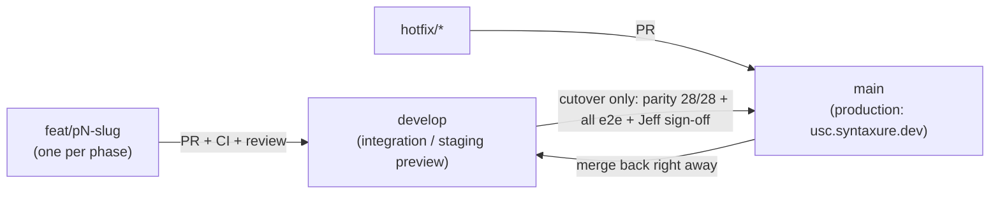

# Public site freeze & branch workflow

> Applies to every person and AI agent working on the Nuxt rebuild (plan: `docs/PROFESSIONAL-SYSTEM-PLAN.md`). Agreed with Jeff on 2026-10-17.

## 1. The promise

The public USC website — every page below, its content, layout, colours, fonts and URLs — **stays exactly as it is today** until Jeff approves a change. The rebuild changes the *portal* (login, dashboard, attendance, admin), not the public site.

| Public routes (must keep working at the same URL) |
|---|
| `/` · `/about` · `/officers` · `/projects` · `/events` · `/events/pag-abi-abi/photobooth` · `/campus-guide` · `/contact` · `/privacy` · `/portal` · `/portal/features` · `/portal/how-it-works` · `/portal/security` · `/portal/faq` |

## 2. How it's guaranteed

1. **Production only deploys from `main`.** `main` keeps the current site until the cutover. Rebuild work never merges into `main` directly.
2. **Port, don't redesign.** In P1 the public pages are moved from the old Vite app (`src/pages/*.vue`, `src/components/**`, available on `main` and tag `pre-nuxt`) into Nuxt **as-is**: same markup, same Tailwind classes, same CMS API calls, same images, same routes.
   - Keep the old colour names working for these pages (`navy`, `navy-light`, `navy-deep`, `gold`, `gold-soft`, `gold-dark`, `paper`, `paper-panel`, `line`, `slate`, …) by defining them as aliases in the Tailwind v4 theme — the P0 theme replaced them with a numbered `navy-50…900` scale.
   - Tailwind v3 → v4 changes some defaults (e.g. border colour, ring width, placeholder colour). Add compatibility CSS for the public layout so the rendering doesn't drift.
   - Public pages use the public layout only; Nuxt UI's app theme must not restyle them.
3. **Automated parity gate** (`tools/public-parity/`): compares every public page on the live site with the new build — content outline must be identical, pixels within 0.05 %, desktop and mobile. It must pass **28/28** before the cutover and on every PR into `develop` that touches public pages, layouts, global CSS or the theme.
4. **Rollback:** the last Vite production build stays tagged `pre-nuxt` and can be redeployed in minutes.

## 3. Branch workflow (reconcile on `develop` after every stage)

- **Start a phase:** branch `feat/p<N>-<slug>` from the latest `develop`.
- **Finish a phase (reconcile):**
  1. Merge the latest `develop` into the phase branch; resolve conflicts there.
  2. CI green (lint, typecheck, unit tests) + the phase's live e2e checks + the parity gate if public files were touched.
  3. PR into `develop`; after review, merge. Update the plan's tracker (§14) in that PR.
  4. Check the `develop` preview deployment.
- **Hotfixes to the live site** go to `main` through a `hotfix/*` PR and are merged back into `develop` immediately, so `develop` never falls behind production.
- **Cutover (end of P1, once):** `develop` → `main` only when the parity gate passes 28/28 against the live site, every live e2e suite passes against the new API, and Jeff signs off. Tag `pre-nuxt` first.

## 4. Status (2026-10-17)

- `develop` reconciled with `main` (`develop` @ `6b37984` = `main` @ `6fdff03` content).
- Open PRs retargeted to `develop`: #24 (plan), #25 (seed roster), #26 (P0).
- P0 (#26) deletes the old `src/` public pages — expected; they're ported in P1. **Do not merge #26 into `main`.**
- Parity gate added and verified (self-check 28/28; injected spacing, text, colour and border drifts all fail).
